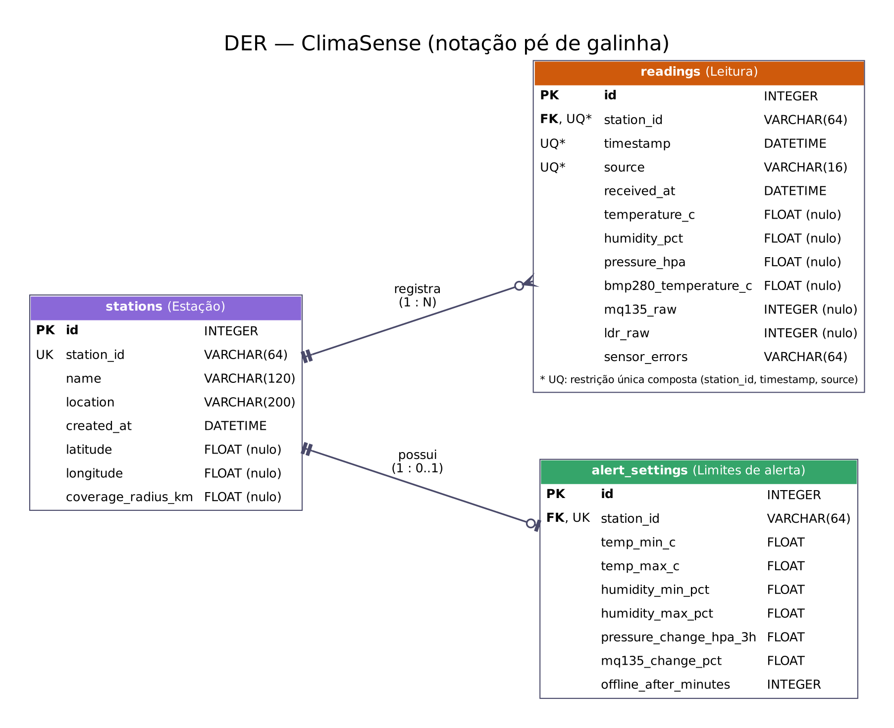
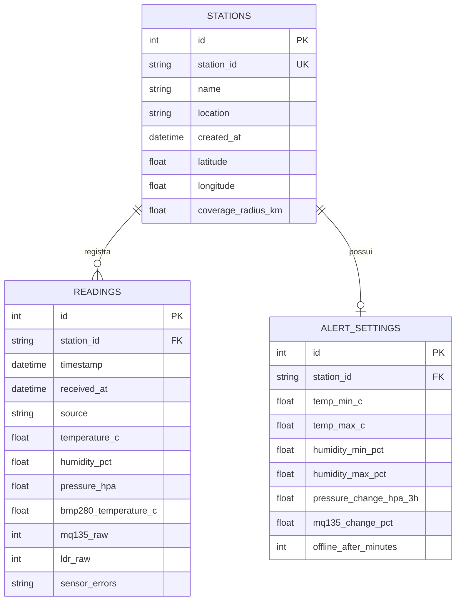

# 4.7 Modelagem do Banco de Dados

Banco padrão: **SQLite** (arquivo `weather.db`). Para **MySQL**, basta trocar `DATABASE_URL` no `.env`
(ver `docs/modelo_fisico_mysql.sql`). O acesso é feito pelo SQLAlchemy (`app/models/`).

## 1. DER (Diagrama Entidade-Relacionamento)

Arquivos: `docs/der.png` (para colar no relatório), `docs/der.svg` (vetorial) e `docs/der.dot` (fonte, Graphviz).

Versão em Mermaid (renderiza direto no GitHub):

### Relacionamentos

| Relacionamento | Cardinalidade | Regra de negócio |
|---|---|---|
| `stations` **registra** `readings` | 1 : N | Uma estação gera muitas leituras; cada leitura pertence a uma única estação. |
| `stations` **possui** `alert_settings` | 1 : 0..1 | Cada estação tem no máximo um conjunto de limites de alerta (criado com valores padrão no primeiro uso). |

## 2. Modelo lógico

Notação: **PK** chave primária, **FK** chave estrangeira, **UK** única, **NN** não nulo.

**stations**(<u>id</u>, station_id, name, location, created_at, latitude, longitude, coverage_radius_km)
- PK: `id` · UK: `station_id` · NN: `station_id`, `name`, `location`, `created_at`
- `latitude`, `longitude`, `coverage_radius_km` são opcionais (estação sem posição configurada = mapa desativado).

**readings**(<u>id</u>, station_id, timestamp, received_at, source, temperature_c, humidity_pct, pressure_hpa, bmp280_temperature_c, mq135_raw, ldr_raw, sensor_errors)
- PK: `id`
- FK: `station_id` → `stations.station_id`
- UK composta: (`station_id`, `timestamp`, `source`), que impede duplicatas quando o ESP32 reenvia a mesma medição
- NN: `station_id`, `timestamp`, `received_at`, `source`, `sensor_errors`
- Medições são **anuláveis**: nulo significa "sensor sem leitura" (o painel mostra "Sem leitura", nunca inventa valor).

**alert_settings**(<u>id</u>, station_id, temp_min_c, temp_max_c, humidity_min_pct, humidity_max_pct, pressure_change_hpa_3h, mq135_change_pct, offline_after_minutes)
- PK: `id`
- FK + UK: `station_id` → `stations.station_id` (a unicidade é o que torna a relação 1 : 0..1)
- NN: todos os campos

> Observação de projeto: as FKs apontam para `stations.station_id` (chave de negócio única, usada pelo ESP32 no JSON)
> e não para `stations.id`. Funciona porque `station_id` é UNIQUE (e indexado, requisito do MySQL para FK).

## 3. Modelo físico

DDL completo, gerado automaticamente a partir dos modelos do código (garante que documentação = implementação):

- `docs/modelo_fisico_sqlite.sql` (padrão do projeto)
- `docs/modelo_fisico_mysql.sql` (testar em MySQL 8 antes de apresentar)

### Dicionário de dados

**stations**

| Coluna | Tipo | Restrições | Descrição |
|---|---|---|---|
| id | INTEGER | PK, auto-incremento | Identificador interno |
| station_id | VARCHAR(64) | NN, UNIQUE, índice | Código da estação (ex.: `estacao_01`), enviado pelo ESP32 |
| name | VARCHAR(120) | NN | Nome exibido no painel |
| location | VARCHAR(200) | NN | Descrição textual do local |
| created_at | DATETIME | NN | Criação do registro (UTC) |
| latitude | FLOAT | nulo | Graus decimais, −90 a 90 |
| longitude | FLOAT | nulo | Graus decimais, −180 a 180 |
| coverage_radius_km | FLOAT | nulo | Raio da área de cobertura, em km |

**readings**

| Coluna | Tipo | Restrições | Descrição |
|---|---|---|---|
| id | INTEGER | PK | Identificador |
| station_id | VARCHAR(64) | FK → stations.station_id, NN | Estação de origem |
| timestamp | DATETIME | NN | Instante da medição (UTC) |
| received_at | DATETIME | NN | Instante em que o servidor recebeu |
| source | VARCHAR(16) | NN | `hardware` (real) ou `simulated` (demonstração) |
| temperature_c | FLOAT | nulo | DHT22, °C (−40 a 80) |
| humidity_pct | FLOAT | nulo | DHT22, % (0 a 100) |
| pressure_hpa | FLOAT | nulo | BMP280, hPa (300 a 1100) |
| bmp280_temperature_c | FLOAT | nulo | Temperatura auxiliar do BMP280 |
| mq135_raw | INTEGER | nulo | MQ-135, leitura bruta do ADC (0 a 4095) |
| ldr_raw | INTEGER | nulo | LDR, leitura bruta do ADC (0 a 4095) |
| sensor_errors | VARCHAR(64) | NN | Sensores com falha, separados por vírgula (ex.: `dht22,bmp280`) |

Índices: `uq_reading_station_ts_source` (UNIQUE composto) e `ix_readings_station_source_ts` (acelera consultas por estação/origem/período).

**alert_settings**

| Coluna | Tipo | Restrições | Padrão |
|---|---|---|---|
| id | INTEGER | PK | — |
| station_id | VARCHAR(64) | FK → stations.station_id, UNIQUE, NN | — |
| temp_min_c / temp_max_c | FLOAT | NN | 10 / 35 |
| humidity_min_pct / humidity_max_pct | FLOAT | NN | 30 / 80 |
| pressure_change_hpa_3h | FLOAT | NN | 3 |
| mq135_change_pct | FLOAT | NN | 25 |
| offline_after_minutes | INTEGER | NN | 15 |

### Migração

Bancos criados antes da inclusão do mapa não têm as colunas `latitude`, `longitude` e `coverage_radius_km`.
O `init_db()` (`app/database/connection.py`) detecta isso e executa `ALTER TABLE ... ADD COLUMN` automaticamente,
preservando os dados existentes (coberto por teste em `tests/test_geo.py`).
